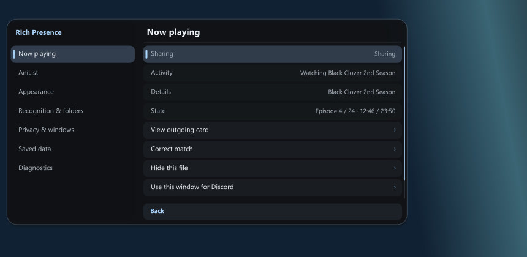
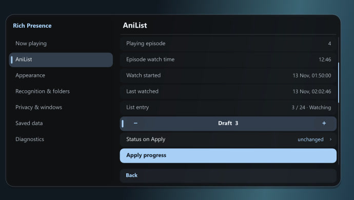
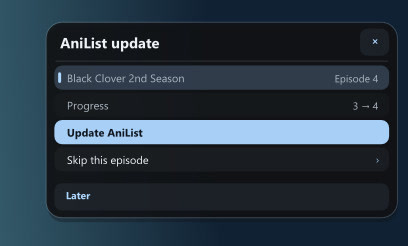

# mpv-rich-presence

Show what you watch or listen to in mpv on Discord. The plugin recognizes anime, movies, TV and music, and can track anime progress on AniList. It runs on Windows and Linux.

## Quick start

1. Get the package for your system from the [release list](https://github.com/Sirye8/mpv-rich-presence/releases) or [build the current source](docs/build.md).
2. Close mpv. Copy the package's `scripts` and `script-opts` folders into your [mpv config directory](docs/user-guide.md#install-or-upgrade). Keep your existing `rich-presence.conf` if you're upgrading.
3. Open a file with Discord running. The package includes the default application ID and metadata services.
4. Press **Alt+p** to open Rich Presence. Hover over any setting for its available choices.

## In the player

| To change | Open |
| --- | --- |
| The text, artwork or timer on the Discord card | **Appearance** |
| How mpv recognizes files in a folder | **Recognition & folders** |
| What gets shared or tracked | **Privacy & windows** |
| A local cache, match or timer | **Saved data** |

## AniList

Open **Alt+p → AniList → Connect account** and approve in your browser. Set **Tracking** to **Manual**, **Ask** or **Automatic** when you're ready to count watch time. You can edit progress with the draft controls and review each proposed change in mpv.

| Edit progress | Review before leaving |
| --- | --- |
|  |  |

## More information

- [User guide](docs/user-guide.md) for installation, settings, recognition, privacy and AniList tracking
- [Build and package](docs/build.md) for source installs and dependency licenses
- [Verification](docs/verification.md) for test commands and release checks

Licensed under [AGPL-3.0](LICENSE). Based on [Alden Wu's mpv-rich-presence](https://github.com/goodtrailer/mpv-rich-presence).
