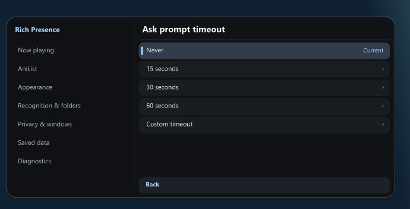

# User guide

- [Install or upgrade](#install-or-upgrade)
- [Use the panel](#use-the-panel)
- [Recognize media](#recognize-media)
- [Connect AniList](#connect-anilist)
- [Track episodes and rewatches](#track-episodes-and-rewatches)
- [Review Ask updates](#review-ask-updates)
- [Manage privacy and saved data](#manage-privacy-and-saved-data)
- [Configure startup defaults](#configure-startup-defaults)

## Install or upgrade

Close mpv and copy the package's `scripts` folder into your mpv configuration directory. On a new install, copy `script-opts` too.

| Setup | Configuration directory |
| --- | --- |
| Windows | `%APPDATA%\mpv` |
| Portable Windows | `portable_config` next to `mpv.exe` |
| Linux | `~/.config/mpv`, or `$XDG_CONFIG_HOME/mpv` when set |
| Custom | The directory selected with `--config-dir` or `MPV_HOME` |

See [mpv's file locations](https://mpv.io/manual/master/#files) for more details.

```text
mpv/
  scripts/
    rich-presence.dll       (rich-presence.so on Linux)
    mpv-rich-presence/
  script-opts/
    rich-presence.conf
```

On upgrade, keep your existing `rich-presence.conf` and `scripts/mpv-rich-presence/data.sqlite3` to preserve preferences and history. If you still have `scripts/rich-presence-conf.lua`, remove that old script so only the bundled bridge loads. The plugin can migrate saved settings and history from `rich-presence/data.sqlite3` when it first creates the new database.

The Windows x64 ZIP includes Python and Chromaprint. The Linux ZIP includes Chromaprint and uses Python 3.9 or newer from your system. Source installs can use `fpcalc` on PATH. Run the Discord desktop app and allow activity sharing to publish a card. The bundled config and public services are ready to use.

## Use the panel

Press **Alt+p**. Use Up and Down to move, Enter to select, Left and Right to change a choice, and Escape to go back. The wheel and touchpad scroll the list independently of keyboard selection. Drag the scrollbar or click its track to move through long lists. Hover over a row for help and the full value. Long values scroll on hover. If a hovered tooltip has more text, the wheel scrolls that tooltip. Click a row marked ↗ or press Enter to open its link.

| Page | Use it to |
| --- | --- |
| Now playing | Inspect the current card, correct a match or choose which window shares to Discord. |
| AniList | Connect, see watch time, edit progress, change tracking settings or review a proposal. |
| Appearance | Preview a preset or edit artwork, language, numbering, timers, links and card layouts. **Apply** saves the preview. |
| Recognition & folders | Choose a provider scope, pin an AniList match, adjust episode numbering or fingerprint a local track. |
| Privacy & windows | Hide a card or folder, choose a publishing window or start a private session. |
| Saved data | Find saved profiles, matches, caches, timers and proposals. Review what a clear operation removes. |
| Diagnostics | See permission, active provider, rule source, tracking and Discord publishing status. |

**Appearance → Panel position** offers six anchors. **Config** uses `panel_position` from the conf file. Top anchors reserve room for the OSC title strip. Set `menu_scale` to resize the panel or `menu_animations=no` for instant transitions.

To open a page from the mpv console, use `script-message-to mpv_rich_presence menu Appearance`.

## Recognize media

**Automatic** uses the v1.0.10 AniList season and sequel rules. When AniList returns both a direct series or season match and a fuzzy one, Automatic prefers the direct match before resolving episode numbers. Explicit movie filenames use the film title and any stated year to distinguish entries within a franchise. If AniList completes without a match, the plugin can try movie or TV lookup. A weak anime result can give way to a confirmed live-action episode or to an exact animated TV episode when the file's runtime is much longer than the AniList entry. Movie verification uses the title and year. Confirmed and manually pinned anime matches keep their priority.

**Diagnostics → Recognition status** shows whether lookup is still running, found a match, finished with local metadata, or encountered an unavailable provider. During an AniList outage, an ambiguous video uses its local title.

Some releases include both a distributor season number and a series-wide episode, such as `S02E02 (053)`. Automatic can use the explicit series-wide number and follow AniList's sequel links to resolve it. A folder with a named arc can also help when its name matches an AniList title or alias returned for the series. The folder comparison happens locally.

For files with no usable title, Automatic can use the immediate folder name. For example, `Example Show/S02E04.mkv` supplies the show title and a specific episode. A bare number such as `04.mkv` can use AniList's episode numbering. TMDB or TVmaze also needs a season from the filename or folder. A generically named movie needs a feature-length runtime and a unique catalog match. Include the year in the folder name, such as `Example Film (2024)`, to distinguish remakes. Lookups send the inferred title and year when available. They do not send the full path.

Common camera and screen recording names stay local in Automatic. Short videos with a bare title and no year, episode marker or TMDB ID skip the fallback movie search. Use **Local only** on a file or folder when you always want the filename or embedded metadata.

Movie and TV lookup prefers TMDB. Wikidata and TVmaze provide fallbacks. Air-date episodes use TVmaze. For music, the card starts with local tags. MusicBrainz checks title, credits, duration and release edition, and Cover Art Archive supplies public artwork when available. An embedded cover stays in mpv. If the music tags are incomplete or inconclusive, the plugin can send a Chromaprint fingerprint and the track duration to AcoustID. The audio file stays on your device.

To classify a directory, open a file inside it and choose **Recognition & folders → Save for → folder**. Then choose **Media recognition**. The rule also covers its subfolders.

| Choice | Lookup |
| --- | --- |
| Automatic | AniList first for video, with film and TV fallback. Music services for audio. |
| Anime | AniList, with the local title on a miss. |
| Movies & TV | TV for filenames with episode numbers or air dates. Otherwise movies first, then TV. |
| Movies | TMDB movies with Wikidata fallback. |
| TV | TMDB TV with TVmaze fallback. |
| Original | AniList for anime and local titles or tags for other media. |
| Local only | Use local titles and tags. A saved manual match can still apply. |

The effective order is file, nearest matching folder, global panel setting, then `recognition_source` in the conf file. Choose **Inherit recognition source** to remove a rule. Saved match corrections still apply. **Fingerprint this file** runs an explicit AcoustID lookup on local audio.

**TV folder rules** and **Local metadata files** are off by default under **Recognition & folders**. A TV folder rule reuses the selected series only for matching titles in that folder. Each file resolves its own episode. Choose **Dedicated folder** only for a single-series directory if files such as `S02E04.mkv` should use the rule. Conflicting titles use regular recognition. Legacy folder-wide TV cards can be inspected in **Saved data**. Create a new rule to replace one.

With **Local metadata files** enabled, place a file such as `Loki.S02E04.mpv-rp.json` next to `Loki.S02E04.mkv`. Use `{"kind":"tv","tmdb":84958,"season":2,"episode":4}`. For a movie, use `kind` set to `movie` and its numeric TMDB ID. The sidecar guides supplemental recognition. AniList retains priority for confirmed anime, and manual file corrections still take precedence.

If two distinct AniList entries still tie after checking the available title, year, and sequel evidence, mpv uses a local card and asks you to correct the match before AniList tracking resumes. To correct only the episode number, use **Now playing → Correct episode**. Previously recorded time stays with its original episode.

You can override the bundled provider access with `tmdb_key` or `acoustid_key`. See [shared TMDB setup](tmdb-metadata.md) for deployment details.

Turn on **Ask before fingerprinting** if you want to approve AcoustID fallback per track. When tags and MusicBrainz leave a local track unresolved, **Fingerprint this file** appears under **Now playing**. Automatic fingerprinting is the default.

## Connect AniList

Open **Alt+p → AniList → Connect account**, then approve on AniList in your browser. Check the account name and avatar on the next page and choose **Connect**. The page reports when mpv has saved the connection. Use **Use another account** if the profile is wrong, switch on AniList, and reconnect from mpv. You can cancel from the browser or the AniList panel. **Connect for this session** keeps the credential in memory until the account helper exits.

Windows uses Credential Manager for a saved sign-in. Linux can use Python keyring with Secret Service. If credential storage is unavailable, sign-in lasts for the worker session. **Disconnect** removes the local credential. Use AniList's connected app settings to revoke access remotely.

The project uses a Cloudflare relay and a Netlify function for the authorization-code exchange. After sign-in, mpv contacts AniList directly for account and list requests. See [public sign-in deployment](anilist-exchange.md).

To use a personal app, register a separate client in [AniList developer settings](https://anilist.co/settings/developer) with the redirect `http://127.0.0.1:47653/callback`. Set `anilist_personal_client=yes` and `anilist_client_id` to its public ID. Enter the secret on the local callback page. Keep secrets and access tokens out of the conf file. The bundled client ID uses the public callback.

## Track episodes and rewatches

| Tracking mode | Behavior |
| --- | --- |
| Off | Stop counting. Previously saved time stays available. |
| Manual | Count real playback time. Edit progress yourself in the panel. |
| Ask | Count time and open a review when a ready update reaches the configured timing. |
| Automatic | Advance confirmed consecutive episodes at the threshold. Review episode gaps, new entries, required status changes and detected extras before leaving. |

- **Threshold** accepts whole minutes from 1 to 1440 and defaults to 15. A minute at 2× counts as one minute. Pauses, buffering, seeks and long observation gaps add no time.
- **Episode watch time** shows real playback time for the current viewing cycle. **Watch started** and **Last watched** show the first and latest credited playback times on the local clock, when recorded.
- **Resume unfinished time** is on by default and continues from a saved counter when you reopen an episode. Windows playing the same episode for the same account share that record.
- **Measure unique footage** is off by default. Turn it on to see how much distinct footage you watched in this cycle. Replaying a scene counts once in this measure. Elapsed watch time and the AniList threshold continue to count real playback time.
- **Keep offline proposals** is off by default. Turn it on to save eligible updates locally while AniList is unreachable and review them after refreshing the list entry.

Use the minus and plus buttons around **Episodes watched**, or Left and Right on that row, to adjust the proposed count. **Apply progress** opens a confirmation with the account, title and proposed change. The worker rechecks the entry before saving. Ordinary progress edits preserve status, score, notes and repeat count. **Status on Apply** lets you choose a status for a manual edit.

Watch tracking uses the matched AniList entry and its resolved season-relative episode number. It needs one identifiable episode. For an entry outside Watching or Rewatching, the first eligible update offers to switch it to Watching or retain the current status. If you keep the status, Automatic mode can advance consecutive episodes until the status changes. A new list entry needs approval.

For a matched fractional episode, recap, special, episode range or unclear season number, Auto shows a review before leaving. **Continue** leaves progress as it is. **View AniList entry** opens the matched title for a manual decision. A review with an eligible whole episode can still offer an explicit progress update.

An entry already marked Rewatching gets its own viewing cycle. Turn on **Rewatch tracking** to offer a new cycle after watching episode 1 of a completed anime. Starting the cycle needs approval because it restarts AniList progress. Reaching the known final episode completes the rewatch and adds one to the repeat count. An unknown total can continue in Rewatching. Use **Start new viewing cycle** to reset local counters and pending updates for the matched entry.

## Review Ask updates

| Ask timing | When it opens |
| --- | --- |
| At threshold | As soon as a proposal is ready. Playback continues. |
| End of episode | At natural playback completion, before the playlist advances. |
| Before leaving | At natural completion or when a standard quit or playlist binding would leave the episode. |

With **Before leaving**, the player stays responsive while a quit or playlist action waits for your decision. At natural completion, the last frame stays visible so mpv can still draw overlays and process input. After your choice, mpv resumes the requested action. **Later**, **×**, Escape, and a timed dismissal leave the proposal in **Pending updates**. **Skip this episode** clears the proposal for the current cycle.

- **Ask prompt position** controls **At threshold** and **End of episode**. It defaults to the upper right.
- **Before leaving position** controls that timing in Ask and all Auto reviews. It defaults to the center, with six other positions available.
- **Ask prompt timeout** defaults to 30 seconds. Choose a preset, enter a custom 5 to 300 seconds, or select **Never** to wait for a choice.



The standard left-click Next and Previous buttons in mpv's OSC and the standard `next` and `prev` controls in uosc use the same review route. **End of episode** still waits for natural completion. If you leave before that and return, an eligible pending proposal can appear at the end.

Direct commands from custom OSC controls, other scripts or IPC can leave immediately. The proposal stays in **Pending updates**. Route a custom Next or Quit control through the review binding to make it wait in **Before leaving**. For example, in `input.conf`:

```ini
Ctrl+n script-message-to mpv_rich_presence review-before "playlist-next weak"
Ctrl+q script-message-to mpv_rich_presence review-before "quit-watch-later"
```

## Manage privacy and saved data

**Privacy & windows** can hide only the card, switch to a generic card, or start a private session that stops both lookups and tracking. Folder exclusions and private sessions take precedence. **Track while hidden** lets AniList continue when Discord sharing is off and the file is otherwise eligible. A new or resumed file can claim Discord unless another player is pinned.

Open **Folder filters** from **Privacy & windows** or **Recognition & folders**. Review whether the current file passes, choose a filter mode, and add or remove folders. These edits apply across mpv windows and override the conf. **Restore conf filter** returns both settings to their file values. An exception can allow just the open file or all local files in the current window until it closes. Exceptions still honor private sessions and separate exclusions.

**Saved data** groups profiles, matches, caches and the current account's AniList records. Open a category to search or clear its entries. Metadata cache rows show their provider and expiry rather than the internal key. Hover for the key and the effect of clearing the record.

**Release idle Discord pin** is off by default under **Privacy & windows**. Turn it on to release a window's exclusive pin when playback ends, sharing becomes unavailable, or the pause timeout expires. Pin the window again if you want to reclaim it.

The database lives in `scripts/mpv-rich-presence/data.sqlite3` under your config directory. **Clear watch** resets the affected counters and removes their pending proposals and skips. If you keep watching the same episode, it can qualify again once it earns the threshold. Completed local history and saved AniList progress are kept. **Reset everything** clears the local profiles, matches, caches and history, disconnects the account and restores the conf defaults. It leaves your AniList list as it is.

Close all mpv instances before removing the plugin folder. The current account helper exits with the player, including when the player is forcibly stopped. If an older installation left a Python process behind, close the helper whose command line points to this plugin's `modules/backend.py`, then remove the folder.

## Configure startup defaults

Edit `script-opts/rich-presence.conf` in your mpv config directory and restart mpv. The tables show the settings in the [shipped config](../script-opts/rich-presence.conf). Saved panel overrides can take precedence for appearance, recognition and panel position.

### Discord, folders and recognition

| Setting | Default | What it does |
| --- | --- | --- |
| `application_id` | Bundled Discord application | Use the bundled value or enter the numeric ID of your own Discord application. A blank or invalid ID disables Discord publishing. |
| `on` | `yes` | Starts Discord sharing. Set `no` to start with sharing off. **Track while hidden** can separately permit lookups for eligible AniList tracking. |
| `folder_filter_mode` | `disabled` | Use `whitelist` to allow only listed folders or `blacklist` to exclude listed folders. The filter covers subfolders, Discord sharing and lookups. An empty whitelist allows no files. An empty blacklist excludes none. |
| `folder_list` | Empty | Absolute folder paths separated by semicolons. Quotes are optional. For example, `D:\Anime;E:\Videos\Movies`. |
| `recognition_source` | `auto` | Pick the default recognition mode. Library choices are `auto`, `anime`, `movie-tv`, `movie`, `tv`, `original` and `local`. Provider-specific values are `tmdb-movie`, `tmdb-tv`, `tvmaze`, `wikidata`, `musicbrainz`, `acoustid` and `stream`. See [Recognize media](#recognize-media) for the library choices. |
| `pause_timeout` | `1800` | Seconds of paused playback before Discord hides the card. Use `0` to disable the timeout. |

### Appearance and panel

| Setting | Default | What it does |
| --- | --- | --- |
| `appearance_preset` | `original` | Choose `original` for the standard card, `clean` for fewer details, `detailed` for more metadata, or `private` for a generic card. Preview these in **Appearance**. |
| `menu_key` | `Alt+p` | Shortcut that opens the panel. Use an mpv key name. |
| `menu_scale` | `1` | Positive size multiplier for the panel and Ask popup. For example, `0.9` is smaller and `1.2` is larger, subject to available window space. |
| `menu_animations` | `yes` | Enables panel transitions and horizontal scrolling on hover. Set `no` for instant transitions. The tooltip still shows the full value. |
| `panel_position` | `top-left` | Choose `top-left`, `top-center`, `top-right`, `bottom-left`, `bottom-center` or `bottom-right`. The panel's **Config** option uses this setting. Set the Ask popup position separately in **AniList**. |

### Account helper and provider access

| Setting | Default | What it does |
| --- | --- | --- |
| `python` | Auto | Uses bundled Python on Windows when present. Otherwise it runs `python` on Windows or `python3` on Linux. Set the executable path to use a different Python 3.9+ interpreter. |
| `anilist_client_id` | Bundled AniList client | Set a different public numeric client ID only when using your own application. |
| `anilist_personal_client` | `no` | Set `yes` and leave `anilist_exchange_url` empty to use a personal client with the localhost callback. Enter the client's secret on the local sign-in page. |
| `anilist_exchange_url` | Empty | Uses the bundled exchange with the bundled client. For a self-hosted exchange, enter its HTTPS origin without a path or trailing slash, and set the matching `anilist_client_id`. |
| `tmdb_key` | Empty | Uses the shared TMDB service. To make direct requests, enter your TMDB **API Read Access Token**. |
| `acoustid_key` | Empty | Uses the bundled AcoustID application key. Set your own application key to override it. |

Keep provider overrides in your local config. Use the browser sign-in flow for AniList secrets and tokens.

Appearance templates support `{title}`, `{artist}`, `{album}`, `{episode}`, `{original}`, `{group}`, `{channel}`, `{details}`, `{state}` and `{year}`. Separate optional pieces with a vertical bar, for example `{artist}|{title}`. A piece is skipped when its fields are missing.

To toggle the card with a key, add a line such as `D script-message-to rich_presence toggle` to `input.conf`. The same target also accepts `on`, `off`, `application_id <id>`, `folder_filter_mode <mode>`, `folder_list <paths>` and `pause_timeout <seconds>`.
